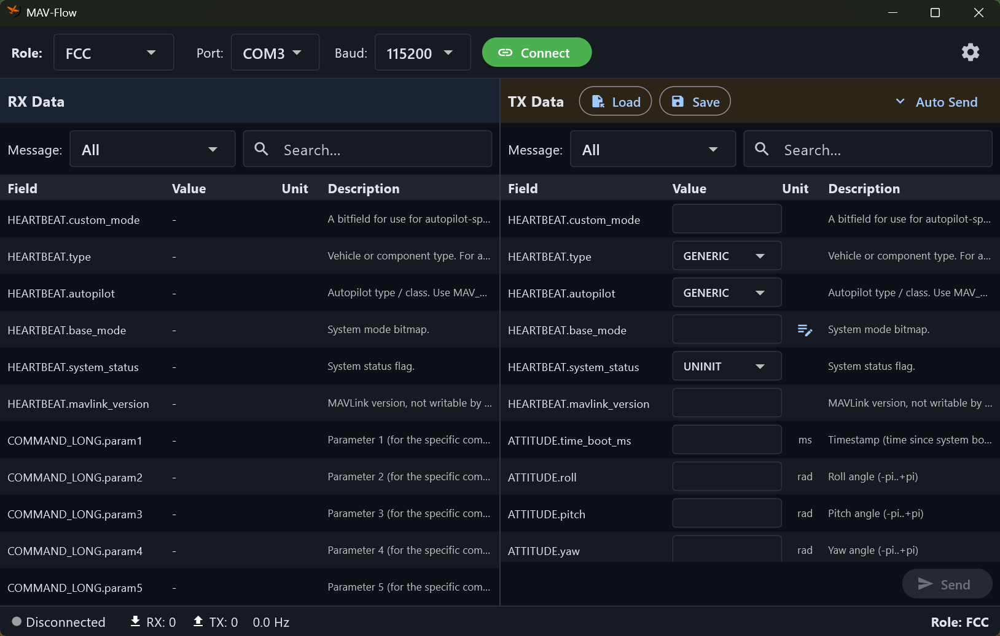

# MAV-Flow

**MAV-Flow** is a MAVLink protocol-based message transceiver tool. It can communicate with real hardware devices or simulate peripheral devices for system testing.

## Key Features

- 🔄 **MAVLink v2 Message Transceiver** - Real-time communication via serial port
- 📊 **Data Table Monitoring** - Real-time display of received message field values
- ✏️ **Message Editing & Transmission** - Edit field values, manual/auto send
- 🎭 **Role-based Configuration** - Configure TX/RX messages per role (GCS, FCC, MC, GEN3)
- 🔧 **XML → JSON Conversion** - Convert MAVLink XML specs to app-compatible JSON
- 🌙 **Dark Theme Support** - Light/Dark theme selection
- 🔄 **Auto Update** - In-app updates via GitHub Releases

## Download

[**Download Latest Version**](https://github.com/guruchun/mav-flow/releases/latest)

Download `mav-flow-x.x.x-windows-x64.zip`, extract it, and run `mav-flow.exe`.

## Quick Start

1. **Select Role** - Choose a role (GCS, FCC, etc.) from the toolbar.
2. **Connect Serial Port** - Select port and baud rate, then click Connect.
3. **Receive Messages** - View received messages in the left RX Data panel.
4. **Send Messages** - Edit field values in the right TX Data panel and click Send.

## Screen Layout



## Use Cases

MAV-Flow can run multiple instances simultaneously to create various test environments:

- **Instance 1**: DEV role (for real H/W device)
- **Instance 2**: FCC role (simulation)
- **Instance 3**: GCS role (simulation)

This enables testing communication between a real device and virtual devices.

## Documentation

- 📖 [**User Guide (HowToUse.md)**](docs/HowToUse.md)

## System Requirements

- Windows 10/11 (x64)
- Serial port (including USB-to-Serial adapters)

## Build (For Developers)

```powershell
# Install dependencies
flutter pub get

# Run
flutter run -d windows

# Release build
.\scripts\build-release.ps1
```

## License

MIT License
